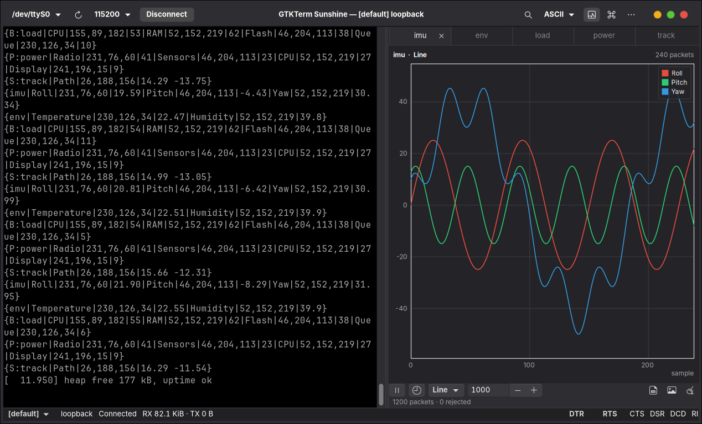
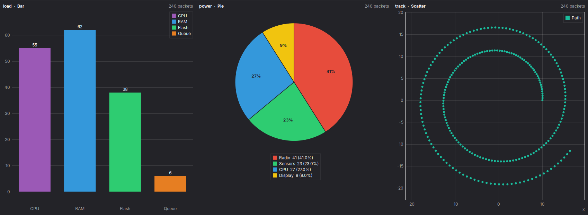
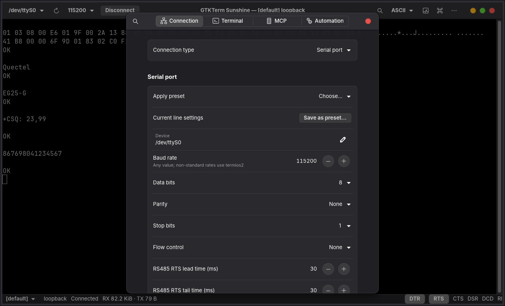
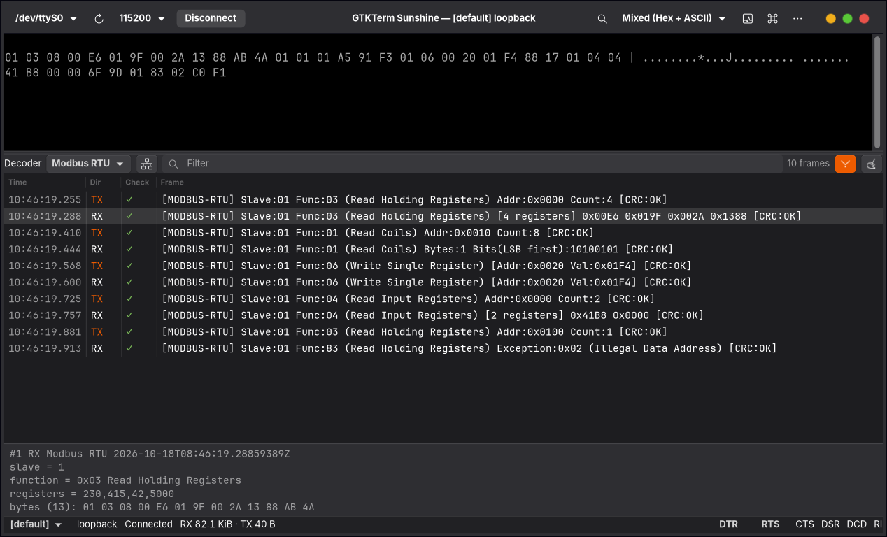
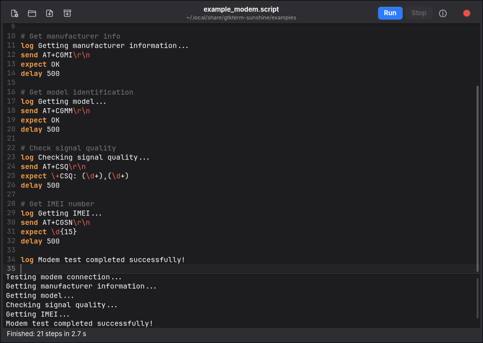
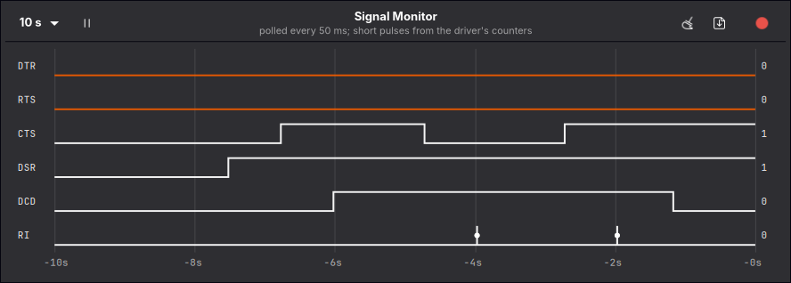
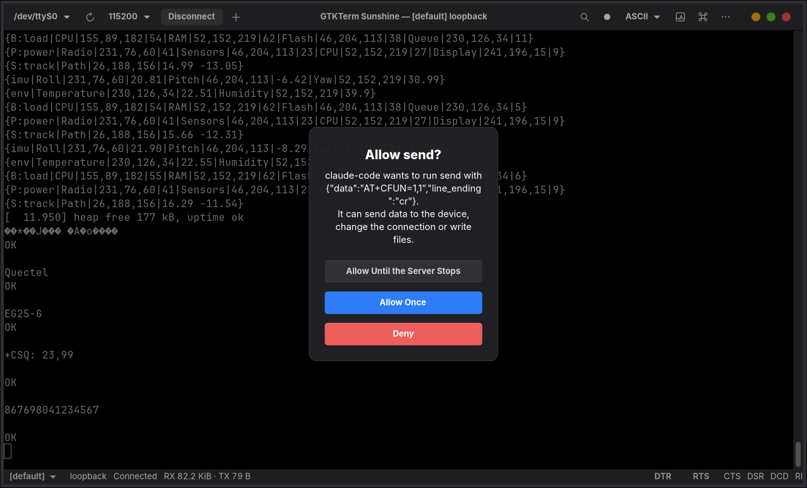

# GTKTerm Sunshine

A Linux serial / TCP / UDP terminal with **live plotting of device data** ("Sunshine" packets)
and a built-in **MCP server**, so AI agents such as Claude Code can drive your devices.



This is a Rust rewrite of the GTKTerm "Sin of Pride" fork (the C version lives at tag
`legacy-c-v1.99.1`). Status **2.0.0**: every feature of the C version is implemented
(including its never-wired modules; see [docs/feature-parity.md](docs/feature-parity.md)): GTK 4 /
libadwaita application, headless terminal, MCP server, macros, presets, protocol decoders, file
transfers, automation scripts, port control and the signal monitor. On top of that: tabs (one
connection each), a send bar, DTR/RTS at open, auto-reconnect, quick capture, chart controls,
a complete MCP server (subscriptions, completions, approval, rate limit, activity pane) and one
window for every launch. Real-device checks: [docs/testing/hardware.md](docs/testing/hardware.md);
history and plan: [docs/ROADMAP.md](docs/ROADMAP.md).

## Sunshine packets

Print lines like these from your firmware and they are plotted, one chart per ID:

```
{P0|Temperature|255,0,0|23.5}
{imu|Roll|255,0,0|45.2|Pitch|0,255,0|12.3|Yaw|0,0,255|180.0}
{B:levels|Red|10|Green|20}        chart prefixes: L: line (default), B: bar, P: pie, S: scatter
{S:xy|path|1.0 2.5}               two values = an X/Y point
```



Colours (`R,G,B`) are optional, decimals use `.`. Full spec: `gtkterm-sunshine --mcp-stdio`
exposes it as the resource `gtkterm://docs/sunshine-protocol`, or read
[crates/gtkterm-mcp/src/sunshine_protocol.md](crates/gtkterm-mcp/src/sunshine_protocol.md).

## Build and install

```bash
# needs: libgtk-4-dev libadwaita-1-dev libvte-2.91-gtk4-dev libgtksourceview-5-dev libudev-dev
cargo xtask install                      # into ~/.local (binary, desktop entry, icons, man page, completions, translations)
cargo xtask install --prefix /usr --destdir pkg/   # staging for packages
# Headless terminal + MCP server only, without GTK:
cargo build --release -p gtkterm-gui --no-default-features
```

## The window

- Header bar: port (live udev list), baud rate, Connect, new tab, view mode (ASCII, hex,
  binary, decimal and mixed dumps), search, chart panel, menu.
- Tabs: one connection per tab (Ctrl+Shift+T or "+" opens a profile in a new tab,
  Ctrl+Shift+W closes it, Ctrl+PgUp/PgDn switch). The header, menus and shortcuts act on the
  selected tab; open tabs come back at the next start. Agents (MCP) see every tab's session.
- Charts: one tab per packet ID (at most 64); scroll to zoom, drag to pan, double-click or
  *Follow* to follow the newest data, click a legend entry to hide a series, hover for values.
  The legend shows each series' newest value with min…max and mean of what is visible. Toolbar:
  pause, follow, time axis, chart type, history length, *show the newest N s/samples*, lock the
  Y range, CSV/PNG export. Type, history, axis and span are remembered per packet ID.
- Status bar: profiles, endpoint, RX/TX counters, DTR/RTS toggles, CTS/DSR/DCD/RI, log and MCP state.
- Preferences cover every port and terminal setting, MCP and automation:

  
- Send bar (Ctrl+Shift+I): a line of text (escapes `\r \n \t \xHH`) or hex bytes with a
  line ending, a history (Up/Down) and *repeat every N ms*. The red button in the header
  captures to an auto-named log in one click.
- Per profile: what Enter sends (CR, LF, CR LF), a delay after each byte, DTR/RTS levels when
  the port opens (both *Off* keeps ESP32/Arduino boards from resetting), reconnect automatically
  when the device returns, clear the terminal and start a log on connect.
- Shortcuts use Ctrl+Shift or F-keys (Ctrl+letter goes to the device); press Ctrl+? for the list.
  F11 is fullscreen, Ctrl+plus/minus/0 zoom the terminal.
- `kill -USR1 <pid>` opens the port, `kill -USR2 <pid>` closes it (as in GTKTerm).
- The interface is translated with gettext; German is complete (`LANGUAGE=de gtkterm-sunshine`).

## Macros and presets

Macros (keyboard icon in the header bar) are step lists, edited as text:

```
send: ATZ\r                 # escapes: \r \n \t \0 \e \\ \xHH
expect[2000]: OK\r\n        # wait up to 2 s for a regular expression
wait: 500 ms
send[250]: AT+CSQ\r         # pause 250 ms, then send
```

Give a macro a shortcut (F2–F4, F9–F12 or any combination with a modifier that is not an
application shortcut), show the macro bar, or record what you type (Macros → Record). Macros are
stored in `~/.config/gtkterm-sunshine/macros.json`; old GTKTerm macros are imported once.

Preferences → Connection → *Apply preset* fills in line settings (Arduino, ESP32, GPS, HC-05,
Modbus RTU 8E1, modem, Raspberry Pi, STM32, legacy 7E1, 921600 RTS/CTS); *Save as preset* adds
your own; menu → *Import Presets…* reads the old GTKTerm presets JSON.

## Protocol decoders

Menu → *Decoder* (or the selector in the frames pane, Ctrl+Shift+D) decodes the traffic into
frames: AT commands, NMEA 0183, Modbus RTU / ASCII / TCP, CAN as candump text or SLCAN,
EtherCAT, or *Auto-detect*. Sent data is decoded as requests and received data as responses,
so a Modbus master session shows both sides; checksums (CRC, LRC, NMEA) are verified and
failures marked. *Record Modem Line Changes* adds a frame whenever DTR/RTS/CTS/DSR/DCD/RI
change (the *RS232 signals* decoder records only those). Frames are reassembled across reads,
Modbus RTU frames by CRC and the 3.5-character gap. The decoder is saved with the profile.



## File transfers

Menu → *Send File…* (Ctrl+Shift+R) and *Receive File…* (Ctrl+Shift+E): XMODEM (CRC, falls
back to the checksum), XMODEM-1K, YMODEM batches (names, sizes and times kept) and YMODEM-G,
built in; ZMODEM through lrzsz (`sz`/`rz`, package `lrzsz`). *Raw* sends a file's bytes as they
are. Start the receiver on the device first (`rx`, `rb`, `rz`, or a bootloader's upload
prompt). While a transfer runs it owns the port: typed input is refused and protocol bytes
stay out of the terminal; the status bar shows progress and a cancel button. Received files
are never overwritten (`name (1).ext`), and names from the device cannot leave the folder.

## Automation scripts

Menu → *Scripts…* (Ctrl+Shift+J) opens an editor for `.script` files: run (Ctrl+Return), stop,
watch the running line and the `log` output. Scripts written for the C GTKTerm run unchanged
(`data/examples/*.script`); new are labels, `goto`, `if … goto`, `if_match … goto`, `timeout`,
`set`, `include`, `send_hex`, `send_file`/`receive_file`, `exit` and `fail`.



For example:

```
send AT+CSQ\r
expect \+CSQ: (\d+),(\d+)
if ${MATCH_1} == 99 goto no_signal
log signal ${MATCH_1}
exit
no_signal:
fail no signal
```

`exec` runs a program without a shell (arguments are split before `${…}` is expanded, so
received data cannot inject anything) and only when allowed (Preferences → Automation,
`--allow-exec`). Full reference: [crates/gtkterm-mcp/src/script_language.md](crates/gtkterm-mcp/src/script_language.md)
or the editor's help button. Headless, for test benches and CI:
`gtkterm-sunshine --headless -p /dev/ttyUSB0 --script flash.script` exits with the script's result.

## Signals and port control

*Signal Monitor* (Ctrl+Shift+M) draws DTR, RTS, CTS, DSR, DCD and RI over the last 10–300 s;
lines are polled every 50 ms and pulses shorter than that are recovered from the driver's
transition counters. Export as CSV (`Timestamp,DTR,RTS,CTS,DSR,DCD,RI,Changed Signals`).



Preferences → Connection has the break length, RS485 RTS polarity and "receive while sending";
the menu has *Flush Buffers* (discards queued sends and the driver's buffers) and *Detect Baud Rate* (experimental: tries common rates and picks
the one where the device's output reads as text without framing errors).

## Use

```bash
gtkterm-sunshine -p /dev/ttyUSB0 -s 115200                      # window, opens the port
gtkterm-sunshine --headless -p /dev/ttyUSB0 -s 115200          # terminal on stdin/stdout
gtkterm-sunshine --headless --hexdump --tcp 192.168.1.50:23     # hex dump of a TCP stream
gtkterm-sunshine --headless --udp '9000->10.0.0.7:9001' --log-file run.csv
gtkterm-sunshine -U bench -p /dev/ttyACM0 -s 921600 -S          # save a profile
gtkterm-sunshine -L                                             # list profiles
gtkterm-sunshine --new-tab -p /dev/ttyUSB1 -s 9600              # with the window open: a new tab
gtkterm-sunshine probe.script                                   # open a script in the editor
```

One window serves every launch: a second `gtkterm-sunshine` with a port, `--tcp`/`--udp`,
`-U profile` or `--new-tab` adds a tab to the running window (and `--script` runs there);
without them it only brings the window to the front. `.script` files open in the script
editor, also from the file manager, and the launcher's *New Tab* action opens a tab.
`--config FILE` starts a separate instance with that configuration.

The GTKTerm options keep their names (`--port/-p`, `--baudrate/-s`, `--bits/-b`, `--parity/-a`,
`--stopbits/-t`, `--flow_control/-w`, `--term_echo/-e on|off`, `--show_config/-V`, ...); `-h`
is help, so auto-LF moved from `-h` to `-j`. Settings live in
`~/.config/gtkterm-sunshine/config.toml`; an old `~/.config/.gtktermrc` (C GTKTerm) or
`~/.gtktermrc` (GTKTerm 1.x, including its macros) is imported once. `man gtkterm-sunshine`
lists every option, file and signal.

## MCP (AI agents)

```bash
claude mcp add gtkterm -- gtkterm-sunshine --mcp-stdio            # headless, agent owns the port
```

Or share the open window with an agent: menu → *MCP Server for AI Agents*; the toast copies the
`claude mcp add --transport http …` command.

Then ask e.g. *"open /dev/ttyUSB0 at 115200, wait for a Sunshine packet and summarise the
Temperature series"*. Tools cover ports, send/read/expect, modem lines, Sunshine series and
logging, decoded frames, Modbus requests (`modbus_request` builds the frame with its CRC
and returns the parsed registers) and file transfers with progress (`file_send`,
`file_receive`, limited to `~/.local/share/gtkterm-sunshine/transfers` plus `--mcp-allow-dir`),
scripts (`script_run`, `exec` only with `--mcp-allow-exec`), the signal history, line settings
(`configure_port`) and auto-baud. Agents can subscribe to resources (received data, status,
charts, frames) instead of polling, with MCP 2026-07-28 `subscriptions/listen` or the older
`resources/subscribe`. `--mcp-read-only` hides everything that writes, and write calls are limited
to 20 per second per agent (`--mcp-rate`). In the window, an agent's first change waits for your
OK (*Deny*, *Allow Once*, *Allow Until the Server Stops*), menu → *Agent Activity* lists every
call, and all calls are recorded in `~/.local/share/gtkterm-sunshine/mcp-audit.jsonl`. See
[docs/mcp.md](docs/mcp.md); `gtkterm-sunshine --mcp-dump-schema` prints all tool schemas.



## Development

```bash
cargo xtask check                          # what CI runs: fmt, clippy, all tests (GUI in Xvfb), deny/audit/machete, MCP Inspector
cargo xtask cov                            # line coverage (minimums: protocols/charts 85 %, core/MCP 70 %)
cargo xtask bench-pipeline                 # receive throughput; criterion benches: cargo bench -p gtkterm-protocols
cargo nextest run                          # core, protocols, MCP
cargo nextest run -p gtkterm-gui --no-default-features   # binary end-to-end tests
cargo run -p gtkterm-testkit --bin sunshine-gen -- /tmp/ttyB --rate 50   # test data
cargo run -p gtkterm-testkit --bin sunshine-gen -- /tmp/ttyB --device modbus-rtu   # fake slave (also at, nmea)
cd fuzz && cargo +nightly fuzz run sunshine_scanner
cargo xtask po                             # after changing UI strings: update po/*.pot and po/*.po
```

Translations: mark UI strings with `gettext("…")`, `gettext_f("… {name} …", &[("name", &v)])`
or `n_!("…")` (constant tables). To add a language, list it in `po/LINGUAS`, run
`cargo xtask po` and translate `po/<lang>.po`.

Regression guards for every defect of the C version:
[crates/gtkterm-core/tests/regressions/README.md](crates/gtkterm-core/tests/regressions/README.md).
Debugging recipes: [docs/debugging.md](docs/debugging.md). Hardware checklist:
[docs/testing/hardware.md](docs/testing/hardware.md).

## License

GPL-3.0-or-later, like GTKTerm.
