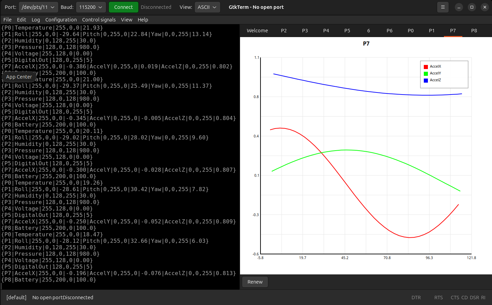

# GTKTerm - Sin of Pride Version

My custom terminal app with real-time chart visualizations!



## What is this?

So basically I took GTKTerm and added this visualization feature I call "Sunshine". You can send specially formatted data from your Arduino (or whatever microcontroller) and it'll show up as live charts. I made this for a class project but it actually turned out pretty useful for monitoring sensors and debugging embedded stuff.

## Cool Features

- Normal serial terminal stuff (USB ports, TCP/UDP, different baud rates)
- Hex and ASCII views
- **Sunshine Visualizations** - the main thing I added:
  - Line charts (for temperature over time and stuff like that)
  - Bar charts (comparing multiple values)
  - Scatter plots (finding correlations maybe?)
  - Pie charts (percentages and distributions)
- Some other things that were already in GTKTerm (macros, protocol decoders, logging)

## How to Send Data (The Sunshine Format)

Just send packets like this from your device:
```
{PacketID|SeriesName|R,G,B|value}
```

Real examples that actually work:
```
{P0|Temperature|255,0,0|23.5}
{P1|Roll|255,0,0|45.2|Pitch|0,255,0|12.3|Yaw|0,0,255|180.0}
```

The program automatically makes new charts when it sees a new packet ID. Pretty neat!

You can put multiple data series in one packet if they're related (like the Roll/Pitch/Yaw example above).

## Building It

You'll need these installed first:
- GTK4 (version 4.6.0 or newer)
- VTE (the terminal widget thing, version 0.69.92+)
- GLib 2.0 (2.66+)
- Meson (for building)

To build:
```bash
meson setup build
ninja -C build
```

Run it without installing:
```bash
./build/src/gtkterm-sin-of-pride-version
```

Or if you want to install it properly:
```bash
sudo ninja -C build install
```

## How to Use

1. Start the program
2. Pick your serial port (dropdown at the top)
3. Set the baud rate if needed (default is usually fine)
4. Hit "Connect" or press F5
5. To see charts: **Ctrl+Shift+V** shows/hides the visualization panel
6. If the text looks weird with stair-stepping, enable "CR LF auto" from the menu

## Random Tips

- I added support for /dev/pts/* virtual ports so you can test without real hardware
- Each chart has a "Renew" button that clears the data if you want to start fresh
- The charts automatically scale to fit your data
- Use different RGB values for each series so you can tell them apart

## Disclaimer

This is a student project I made while learning GTK4 and Cairo. It's based on the original GTKTerm (which is way more professional than my code lol). The Sunshine part is all mine though!

If you find bugs... well, that's probably my fault not theirs.

## License

**Original Code by:** Julien Schmitt

This program is free software: you can redistribute it and/or modify
it under the terms of the GNU General Public License as published by
the Free Software Foundation, either version 3 of the License, or
(at your option) any later version.

This program is distributed in the hope that it will be useful,
but WITHOUT ANY WARRANTY; without even the implied warranty of
MERCHANTABILITY or FITNESS FOR A PARTICULAR PURPOSE. See the
GNU General Public License for more details.

You should have received a copy of the GNU General Public License
along with this program. If not, see <http://www.gnu.org/licenses/>.
